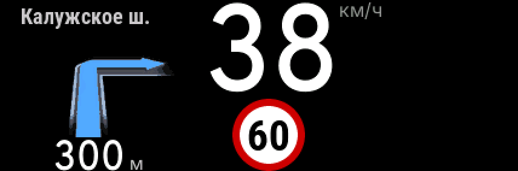
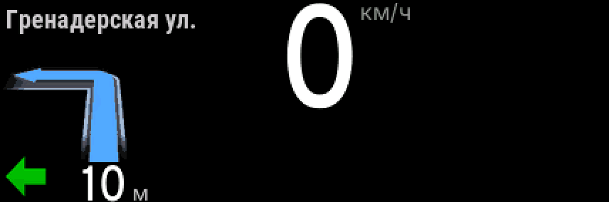
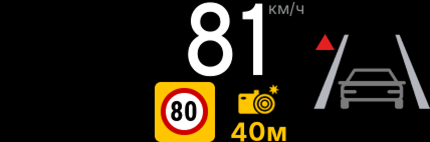
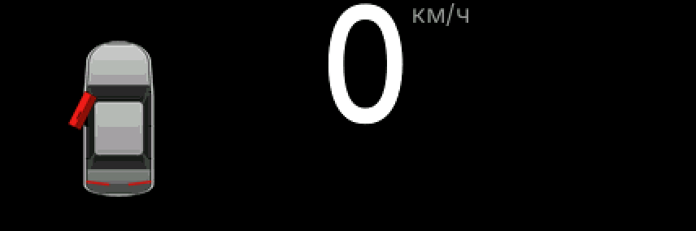
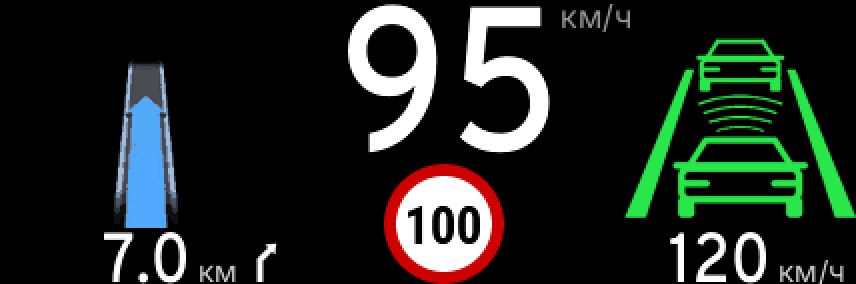
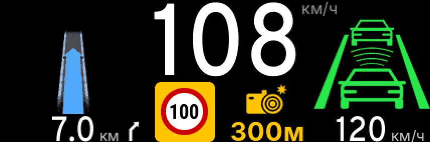
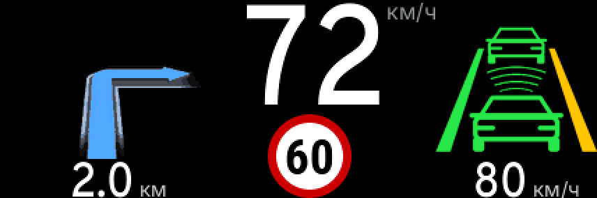
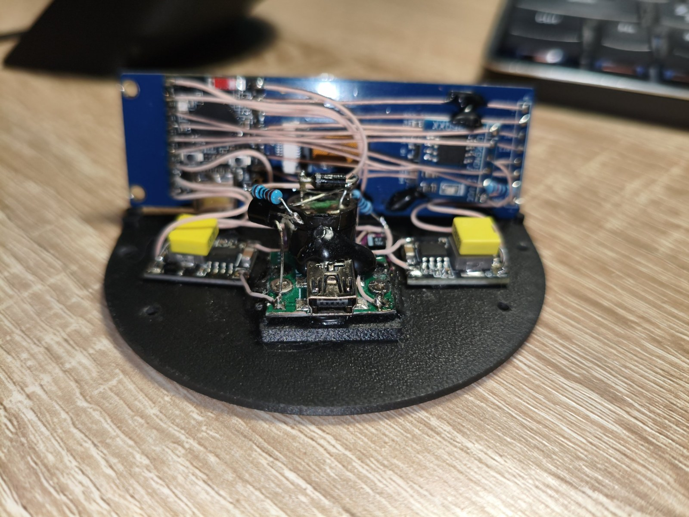
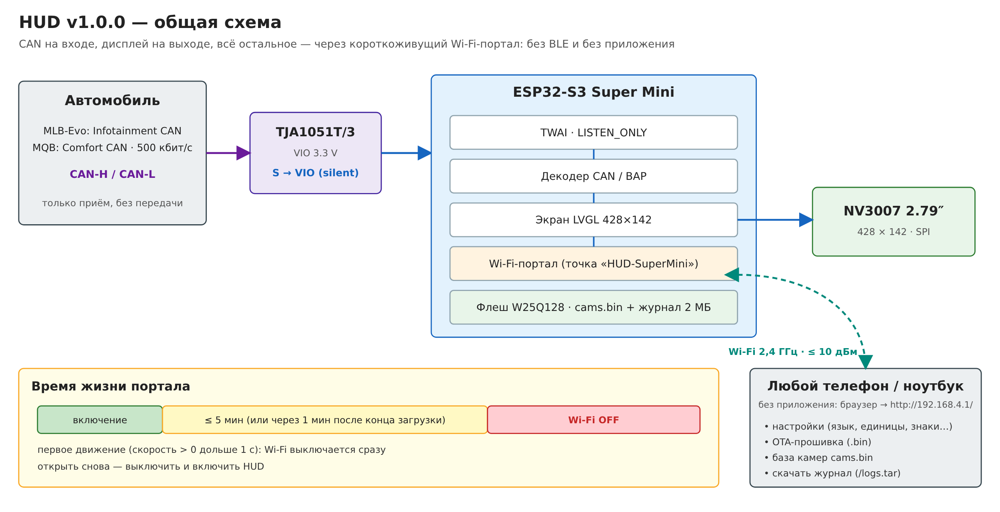
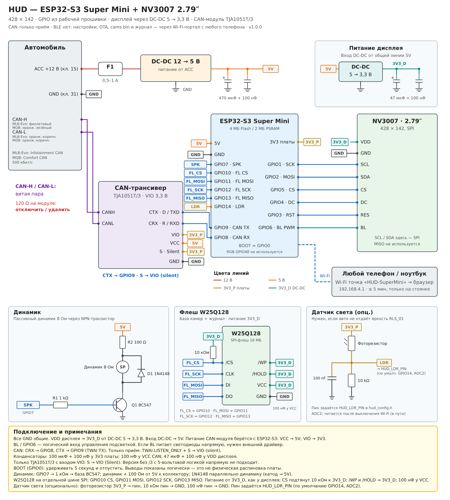

# supermini_hud2

[English version: README_EN.md](README_EN.md) · Версия прошивки **1.0.0**

HUD для Audi A4 B9 (MLB-Evo) на ESP32-S3 SuperMini + NV3007 428×142. Второе поколение проекта
[supermini_hud](../HUD-Audi-A4-B9-MLB-Evo-ESP32-S3-SuperMini-LCD-2.79-NV3007-BLE):

* только минимальный режим отображения (нативно 428×142, без масштабирования), без анимации стрелок;
* без BLE-настроек и без Android-приложения — настройки, OTA и база камер через **Wi-Fi портал**;
* **BLE нет вообще**: данные только по CAN — свой трансивер TJA1051 на шине I-CAN (TWAI, LISTEN_ONLY);
* журнал пишется во флешь W25Q128 и скачивается с портала одним `.tar`.

## Скриншоты

Кадры ниже нарисованы кодом экрана прошивки (`hud_mockup.c`) по реальным CAN-логам поездки (см. [симулятор](tools/hud_sim_win/README.md)).

| | |
|---|---|
|  |  |
| Название улицы над стрелкой манёвра, расстояние, скорость, знак ограничения | Поворот направо через 10 м, индикатор поворотника |
|  |  |
| Камера через 40 м (лимит 80), полосы ACC | Открытая дверь (машина стоит) |
|  |  |
| ACC 120, превью «затем поворот направо» рядом с расстоянием | Камера через 300 м при ведении по маршруту |
|  | |
| Навигация + ACC, заданная скорость 80 | |

## Фото

Прототип со стороны монтажа: плата дисплея на навесном монтаже, два DC-DC модуля, динамик с транзистором, разъём питания mini-USB.

## Портал настроек

После включения HUD поднимает Wi-Fi точку доступа **`HUD-SuperMini`** (пароль в `user_config.h`: `HUD_PORTAL_PASS`, смените его).
Откройте `http://192.168.4.1/` (телефон обычно откроет страницу сам). Через **5 минут** после включения Wi-Fi выключается полностью
(если в этот момент идёт загрузка файла — через минуту после её окончания). **Как только машина тронулась** (скорость > 0 дольше секунды)
Wi-Fi выключается сразу, не дожидаясь пяти минут; незавершённая OTA-загрузка отменяется. Повторно — только выключить и включить HUD.

Мощность передатчика ограничена: Wi-Fi не выше 10 дБм (`HUD_PORTAL_TX_QDBM`, реальный уровень железа 8.5 дБм).

Что есть на странице: язык, единицы, PSD/VZE, название улицы над стрелкой (вкл/выкл), допуск превышения, камеры (показ, сигнал), громкость, фоторезистор (с калибровкой),
загрузка `cams.bin`, скачивание журнала (`/logs.tar`) и OTA-обновление прошивки (`.bin` приложения).

## Название улицы

Над стрелкой манёвра показывается текущая улица из BAP Navigation (только fct 0x14 — короткая форма, как на указателях: «ул. Ленина»). Если название не влезает в окно 138 px, оно бежит строкой по кругу. Название держится до конца маневра: пока идёт ведение по маршруту (RG_Status = 1) оно остаётся на экране до прихода нового; когда маршрут заканчивается — исчезает. Включается и выключается на странице портала («Название улицы над стрелкой»); по умолчанию включено (`HUD_STREET_ON`). Шрифт `hud_font_mstreet` (Roboto Condensed Bold 18, кириллица + латиница) делается так: `python3 tools/gen_min_native.py fonts hud_font_mstreet`.

Если вместе с улицей приходит SignPost (направление, вторая строка fct 0x14), он дописывается в ту же бегущую строку через стрелку: «Гренадерская ул. → Гамбург». Стрелка «→» подмешана в шрифт из Montserrat Bold (в Roboto Condensed её нет).

## Превью второго манёвра

Maneuver_2 из BAP 0x17 («а потом поворот направо») рисуется маленькой белой стрелкой справа от расстояния до манёвра. Картинки — маски `nav_small` (`hud_nav_small.c`, высота 23 px), взяты из проекта на Waveshare 3.49; цвет задаётся `img_recolor`. «Следуй по дороге» и расчёт маршрута как превью не показываются; если справа не хватает места (до камеры/знака, x = 152), превью скрывается.

Проверка разбора SignPost: `gcc -Itests/stubs -Isupermini_hud2 tests/test_signpost.c supermini_hud2/can_decode.c && ./a.out`.

## Журнал во флеше

Всё, что HUD пишет в Serial, дублируется в последние 2 МБ флеши W25Q128 (`HUD_FLASH_LOG` в `user_config.h`; `cams.bin` лежит с начала флеши и на эту область не заходит — его максимальный размер уменьшается на 2 МБ).

* 4 слота по 512 КБ = до 4 файлов `hud.log.0000`, `hud.log.0001`, … (~500 КБ каждый). Когда файл заполнен, начинается следующий; самый старый стирается. После `hud.log.9999` снова `hud.log.0000`.
* Перед каждой строкой — `[секунды.мс с включения]`. Если по CAN принят кадр времени (0x6B2 Diagnose_01, принимается после трёх согласованных кадров), перед ним ещё и дата-время машины: `2026-11-11 10:15:03 [123.456] текст`. Время показывается как на приборке (местное или UTC — как настроено в машине).
* Раз в минуту пишется строка `[hb]` (память, скорость, число кадров CAN); `HUD_FLASH_LOG_HEARTBEAT_S`.
* Скачивание: кнопка «Скачать журнал (.tar)» на странице портала или `http://192.168.4.1/logs.tar` — внутри файлы `hud.log.NNNN` от старого к новому (время изменения — момент, когда стало известно время машины).
* Запись идёт пачками раз в 250 мс: при внезапном отключении питания последняя четверть секунды теряется. После перезапуска запись продолжается в тот же файл.
* Формат: ядро `hud_flog_core.[ch]`, тесты — `tests/test_flog.c`, `tests/test_time.c`.

## Статус

| | |
|---|---|
| Портал, настройки (NVS `hud2`), OTA, cams.bin, флеш-лог | написано, **не собиралось** — нужна проверка в Arduino IDE; ядро лога и время проверены тестами на хосте |
| Минимальный режим 428×142 | реализован (`hud_mockup.c`), проверен headless-рендером LVGL; на плате не проверялся |
| Полный режим, BLE (совсем), приложение, анимация стрелок | убраны |

Сборка: Arduino IDE, папка `supermini_hud2/`, плата ESP32-S3, партиции `partitions.csv`, библиотеки: LVGL 8.4.0, GFX Library for Arduino (NimBLE-Arduino больше не нужна).

## Схемы

Схемы доработаны от первой версии проекта: BLE и Android-приложения нет, вместо них Wi-Fi-портал с любого телефона.

**Общая схема** — что с чем связано и сколько живёт портал:

**Подключение** (GPIO из `user_config.h` / `hud_config.h`; цвета проводов CAN для MLB-Evo и MQB; динамик, W25Q128, датчик света):

[SVG](schematics/HUD_supermini2_wiring_ru.svg) · [PDF](schematics/HUD_supermini2_wiring_ru.pdf) · [English: SVG](schematics/HUD_supermini2_wiring_en.svg) · [PDF](schematics/HUD_supermini2_wiring_en.pdf) · [overview EN](schematics/HUD_supermini2_overview_en.png)

Дополнительно:

* [Делитель фоторезистора](schematics/HUD_light_sensor_divider_supermini_ru.svg) (EN: [svg](schematics/HUD_light_sensor_divider_supermini_en.svg)) — вывод на `HUD_LDR_PIN` (по умолчанию GPIO14, ADC2). ADC2 нельзя надёжно читать, пока включён Wi-Fi: датчик нужен в пути, когда портал уже выключен.
* [Доработка WeAct CANFD: аппаратный режим «только приём»](schematics/weact_canfd_mod.md) (RU + EN).

## Симулятор

`tools/hud_sim_win/` — программа для Windows: проигрывает логи сниффера в тот же код экрана, с окном карты (Яндекс / 2ГИС / OSM). Подробности — [README](tools/hud_sim_win/README.md), [README_EN](tools/hud_sim_win/README_EN.md).

## Ресурсы

Шрифты, иконка ACC, значки и стрелки навигации сгенерированы под панель 428×142: `python3 supermini_hud2/tools/gen_min_native.py [images|nav|fonts]`
(нужны Pillow, fontTools, `npm i -g lv_font_conv`). Стрелки берутся из `tools/arrows/arrows.bin` (последний кадр каждой анимации, ×0.74).
