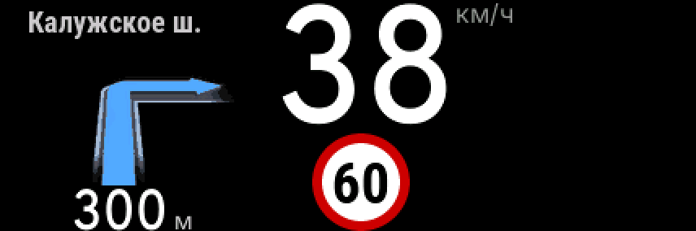
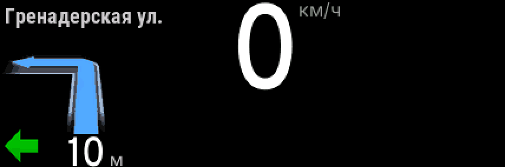
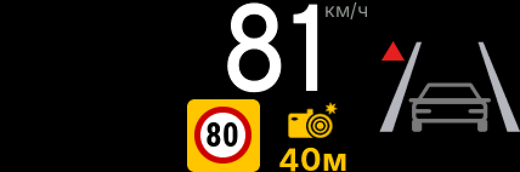
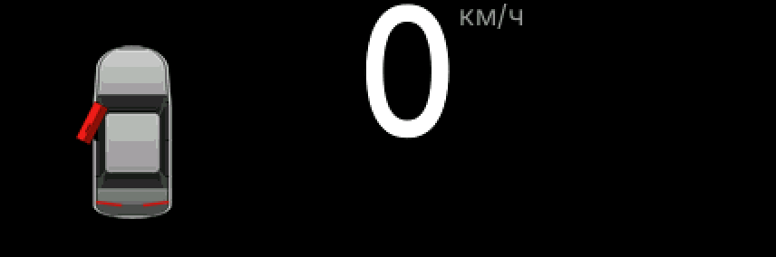
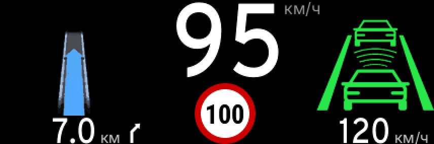
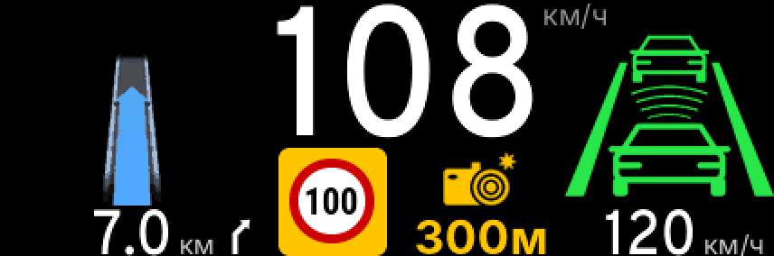
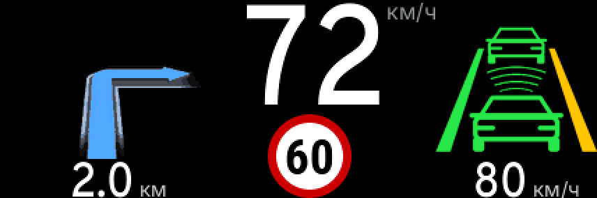
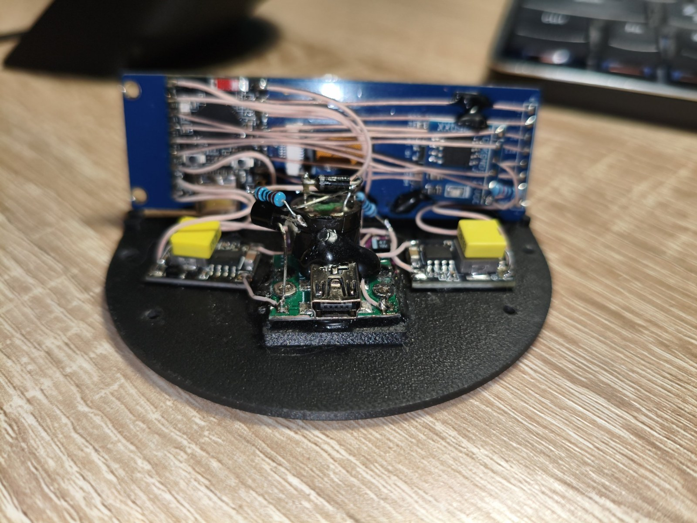
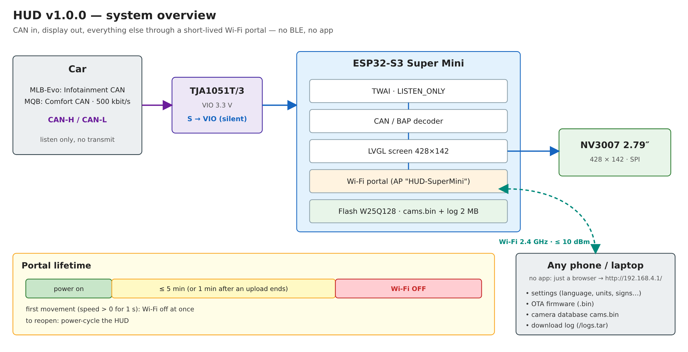
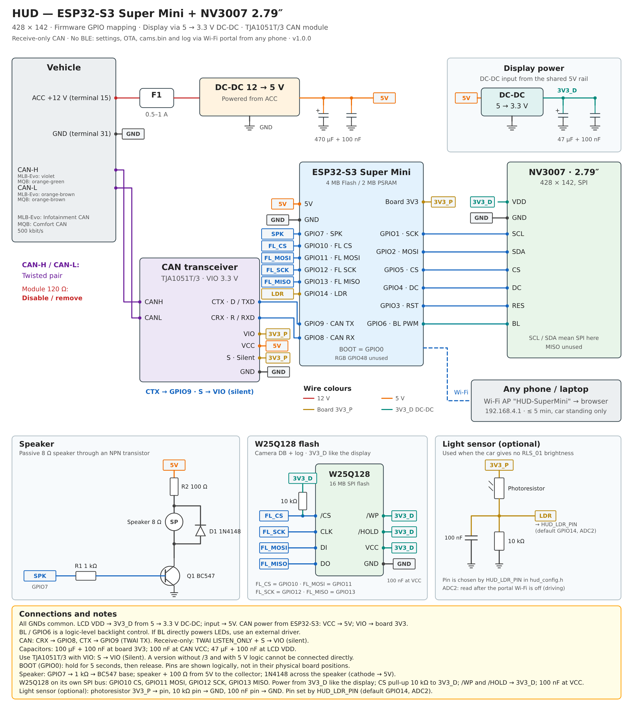

# supermini_hud2

[Русская версия: README.md](README.md) · Firmware version **1.5.0**

> [!NOTE]
> ### A reworked version of [supermini_hud](../HUD-Audi-A4-B9-MLB-Evo-ESP32-S3-SuperMini-LCD-2.79-NV3007-BLE)
> This is the **second generation** of the project — the same hardware and idea, but the screen and the software side were rethought from scratch:
>
> * **A new screen design.** One clean minimal mode at 428×142 in native coordinates: large speed, speed-limit sign, maneuver arrow with distance, the street name as a marquee and a preview of the next maneuver, ACC and cameras.
> * **Simpler inside.** No BLE and no Android app, no full mode and no arrow animation; data comes from CAN only, while settings, OTA, the camera database and the log go through a Wi-Fi portal from any phone.
> * **Less code, more checks.** Flash log, host-side tests of the core and a PC simulator that runs the very same screen code on real logs.

A HUD for the Audi A4 B9 (MLB-Evo, MQB signals also supported) on an ESP32-S3 SuperMini with an NV3007 428×142 display. Second generation of the
[supermini_hud](../HUD-Audi-A4-B9-MLB-Evo-ESP32-S3-SuperMini-LCD-2.79-NV3007-BLE) project:

* minimal display mode only (native 428×142, no scaling), no arrow animation;
* no BLE settings and no Android app — settings, OTA and the camera database go through a **Wi-Fi portal**;
* **no BLE at all**: data comes from CAN only — your own TJA1051 transceiver on the I-CAN bus (TWAI, LISTEN_ONLY);
* the log is written to the W25Q128 flash and downloaded from the portal as a single `.tar`.

## Screenshots

All frames below are rendered by the firmware's own screen code (`hud_mockup.c`) from real CAN logs of a drive (see the [simulator](tools/hud_sim_win/README_EN.md)).

| | |
|---|---|
|  |  |
| Street name above the maneuver arrow, distance, speed, speed-limit sign | Turn right after 10 m, turn-signal indicator |
|  |  |
| Speed camera 40 m ahead (limit 80), ACC lane view | Open door (car stands) |
|  |  |
| ACC set speed 120, "then turn right" preview next to the distance | Camera 300 m ahead while navigating |
|  | |
| Navigation + ACC, set speed 80 | |

## Photo

The prototype from the wiring side: display board with point-to-point wiring, two DC-DC modules, the speaker with its transistor, the mini-USB power connector.



## Settings portal

After power-on the HUD starts a Wi-Fi access point **`HUD-SuperMini`** (password in `user_config.h`: `HUD_PORTAL_PASS` — change it).
Open `http://192.168.4.1/` (a phone usually opens the page by itself). **5 minutes** after power-on Wi-Fi is switched off completely
(if a file upload is in progress at that moment — one minute after it ends). **As soon as the car moves** (speed > 0 for more than a second)
Wi-Fi is switched off immediately; an unfinished OTA upload is cancelled. To get it back, power-cycle the HUD.

Transmitter power is limited: no more than 10 dBm (`HUD_PORTAL_TX_QDBM`, real hardware level 8.5 dBm).

The page offers: language, units, PSD/VZE signs, street name above the arrow (on/off), overspeed tolerance, cameras (show, beep), volume, photoresistor (with calibration),
`cams.bin` upload, log download (`/logs.tar`) and OTA firmware update (the application `.bin`).

## Street name

Above the maneuver arrow the HUD shows the street from BAP Navigation (fct 0x14 only — the short form used on road signs, e.g. "ул. Ленина"). If the name does not fit the 138 px window it scrolls around as a marquee. The name stays until the maneuver is over: while route guidance is active (RG_Status = 1) it stays on screen until a new one arrives; when the route ends it disappears. It can be switched on/off on the portal page ("Street name above the arrow"); on by default (`HUD_STREET_ON`). The font `hud_font_mstreet` (Roboto Condensed Bold 18, Cyrillic + Latin) is generated with `python3 tools/gen_min_native.py fonts hud_font_mstreet`.

If a SignPost (direction, the second string of fct 0x14) comes with the street, it is appended to the same marquee after an arrow: "Гренадерская ул. → Гамбург". The "→" glyph is merged into the font from Montserrat Bold (Roboto Condensed does not have it).

## Second-maneuver preview

Maneuver_2 from BAP 0x17 ("and then turn right") is drawn as a small white arrow to the right of the distance to the maneuver. The images are the `nav_small` masks (`hud_nav_small.c`, 23 px high) taken from the Waveshare 3.49 project; the colour is set with `img_recolor`. "Follow the road" and route calculation are not shown as a preview; if there is not enough room on the right (up to the camera/sign, x = 152) the preview is hidden.

SignPost decoding test: `gcc -Itests/stubs -Isupermini_hud2 tests/test_signpost.c supermini_hud2/can_decode.c && ./a.out`.

## Lane guidance

The HUD passively receives BAP `LaneGuidance` (Navigation_SD, function `0x18`, extended CAN `0x17333211`) and never transmits to the bus. Full arrays of up to 8 lanes, multiple recommended lanes and additional lane directions are supported.

When lane guidance is active, the lanes replace the usual distance at the bottom; the distance moves to a free part of the main maneuver arrow in the smaller street font. Recommended lanes are white and the others are grey, with outer non-recommended lanes fading out smoothly. Additional directions are drawn in grey underneath the main direction of the same lane, without resizing the arrows. `LaneGuidanceOnOff = 0`, route completion or a timeout restores the usual distance display.

Test with all 16 arrays from the 2026-11-21 drive: `gcc -Itests/stubs -Isupermini_hud2 tests/test_lane_guidance.c supermini_hud2/can_decode.c && ./a.out`.

## Flash log

Everything the HUD writes to Serial is duplicated into the last 2 MB of the W25Q128 flash (`HUD_FLASH_LOG` in `user_config.h`; `cams.bin` lies from the start of the flash and never enters this area — its maximum size is reduced by 2 MB).

* 4 slots of 512 KB = up to 4 files `hud.log.0000`, `hud.log.0001`, … (~500 KB each). When a file is full the next one starts; the oldest is erased. After `hud.log.9999` it wraps to `hud.log.0000`.
* Every line starts with `[seconds.ms since power-on]`. If a car-time frame has been received over CAN (0x6B2 Diagnose_01, accepted after three consistent frames), the car date-time precedes it: `2026-11-11 10:15:03 [123.456] text`. The time is shown as on the instrument cluster (local or UTC — as configured in the car).
* Once a minute a `[hb]` line is written (memory, speed, CAN frame count); `HUD_FLASH_LOG_HEARTBEAT_S`.
* Download: the "Download log (.tar)" button on the portal page or `http://192.168.4.1/logs.tar` — it contains `hud.log.NNNN` files from oldest to newest (modification time = the moment the car time became known).
* Writes happen in batches every 250 ms: on a sudden power loss the last quarter of a second is lost. After a restart logging continues in the same file.
* Format: core `hud_flog_core.[ch]`, tests — `tests/test_flog.c`, `tests/test_time.c`.

## Building for MLB-Evo or MQB

The platform is chosen **at build time** with one line in `supermini_hud2/hud_config.h`:

```c
#define HUD_PLATFORM HUD_PLATFORM_MLB_EVO   // Audi A4 B9 and other MLB-Evo cars (default)
// #define HUD_PLATFORM HUD_PLATFORM_MQB    // VAG MQB
```

Or with a compiler flag, without editing the file: `-DHUD_PLATFORM=HUD_PLATFORM_MQB`. After changing the platform, rebuild and flash again — it cannot be switched at run time.

| | MLB-Evo (Audi A4 B9) | MQB |
|---|---|---|
| Bus | I-CAN | Comfort CAN (wire colors are on the wiring schematics) |
| CAN speed | 500 kbit/s (`HUD_CAN_BITRATE_K`) | 500 kbit/s (`HUD_CAN_BITRATE_K`) |
| ACC | frames `0x2A6` / `0x2A8` | `0x2A7` (active) and `0x30C` (set speed, 0.32 km/h step — same format as `0x2A6` on MLB-Evo) |
| Pre sense (AWV) | `0x2A9` | not on the bus |
| Instrument lighting dial | `0x64F` | a byte in `0x5F0` (Dimmung_01) |
| Verified | on the A4 B9 with real logs | only on a pre-facelift Octavia A7 without Virtual Cockpit; some signals are hypotheses |

Street names from navigation are abbreviated on the HUD (Russian street-type words, e.g. «улица» → «ул.», «проспект» → «пр-т»).

Everything else (speed, BAP navigation, PSD / VZE signs, cameras, log, portal) is the same on both platforms.
While there is no CAN data, the screen shows the "HUD VAG" splash with a second line, **MLB EVO** or **MQB** — so you can see at once which platform the firmware was built for.
In the [simulator](tools/hud_sim_win/README_EN.md) the platform is switched in the "Platform" menu: open MQB logs with MQB and A4 logs with MLB-Evo.

## Status

| | |
|---|---|
| Portal, settings (NVS `hud2`), OTA, cams.bin, flash log | written, **not yet built on hardware** — needs checking in the Arduino IDE; the log core and time decoder are verified by host tests |
| Minimal mode 428×142 | implemented (`hud_mockup.c`), verified with a headless LVGL render and the PC simulator on real logs; not verified on the board |
| Full mode, BLE (entirely), app, arrow animation | removed |

Build: Arduino IDE, folder `supermini_hud2/`, board ESP32-S3, partitions `partitions.csv`, libraries: LVGL 8.4.0, GFX Library for Arduino (NimBLE-Arduino is no longer needed).

## Schematics

Redrawn from the first version of the project: no BLE and no Android app — a Wi-Fi portal that works from any phone instead.

**System overview** — what talks to what and how long the portal lives:



**Wiring** (GPIOs from `user_config.h` / `hud_config.h`; CAN wire colours for MLB-Evo and MQB; speaker, W25Q128, light sensor):



[SVG](schematics/HUD_supermini2_wiring_en.svg) · [PDF](schematics/HUD_supermini2_wiring_en.pdf) · [Russian: SVG](schematics/HUD_supermini2_wiring_ru.svg) · [PDF](schematics/HUD_supermini2_wiring_ru.pdf) · [overview RU](schematics/HUD_supermini2_overview_ru.png)

Also:

* [Photoresistor divider](schematics/HUD_light_sensor_divider_supermini_en.svg) (RU: [svg](schematics/HUD_light_sensor_divider_supermini_ru.svg)) — output to `HUD_LDR_PIN` (default GPIO14, ADC2). ADC2 cannot be read reliably while Wi-Fi is on: the sensor matters while driving, when the portal is already off.
* [WeAct CANFD mod: hardware listen-only](schematics/weact_canfd_mod.md) (RU + EN).

## Simulator

`tools/hud_sim_win/` — a Windows program that plays CAN sniffer logs into the very same screen code, with a map window (Yandex / 2GIS / OSM). See [README_EN](tools/hud_sim_win/README_EN.md).

## Resources

Fonts, the ACC icon, icons and navigation arrows are generated for the 428×142 panel: `python3 supermini_hud2/tools/gen_min_native.py [images|nav|fonts]`
(needs Pillow, fontTools, `npm i -g lv_font_conv`). Arrows come from `tools/arrows/arrows.bin` (last frame of every animation, ×0.74).
