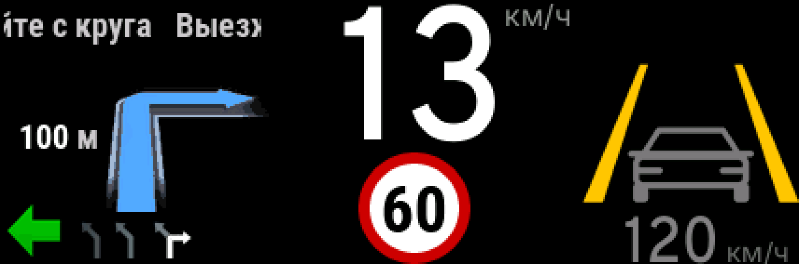
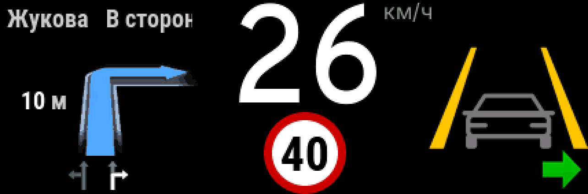

# Как направления накладываются при отрисовке полос

Документ описывает именно текущую реализацию в `supermini_hud2/hud_mockup.c`, а не внешний вид приборной панели Audi. Правила одинаковы для обычной `LaneGuidance (0x18)` и `LaneGuidance2 (0x3D)`.

## 1. Основной принцип

Все направления одной полосы рисуются **в одном и том же месте**, без разведения стрелок по горизонтали и без изменения их размера:

1. сначала дополнительные направления — серым;
2. затем основное направление — поверх них;
3. основное направление активной полосы — белым, неактивной — тоже серым.

Общего фона у совмещённой полосы нет.

```text
Дополнительное направление:  ↖  серый, нижний слой
Основное направление:         →  белый, верхний слой
                              ↓
Результат: серая ветвь ↖ остаётся видна за белой стрелкой →
```

Это **одна полоса с двумя разрешёнными направлениями**, а не две отдельные полосы и не следующий манёвр.

## 2. Порядок направлений

Перед отрисовкой для каждой полосы формируется массив `dirs[]` в следующем порядке:

| Порядок | `LaneGuidance (0x18)` | `LaneGuidance2 (0x3D)` |
|---|---|---|
| 1 | — | `LaneDirection2`, если он не `0xFF` |
| 2 | `LaneSidestreets[]` в порядке сообщения | `LaneSidestreets[]` в порядке сообщения |
| 3 | `LaneDirection` — всегда последним | `LaneDirection1` — всегда последним |

Последний элемент считается основным. Все элементы перед ним — дополнительными.

Значение `0xFF` означает «направление не указано» и пропускается. Если основное направление `0xFF`, белой основной стрелки не будет даже у рекомендованной полосы; дополнительные направления останутся серыми.

Упрощённый эквивалент кода:

```c
if (lane.direction2 != 0xFF)
    dirs[n++] = lane.direction2;       // только 0x3D

for (k = 0; k < lane.side_count; k++)
    dirs[n++] = lane.side[k];

dirs[n++] = lane.direction;            // основное направление — последним

for (k = 0; k < n; k++) {
    if (dirs[k] == 0xFF) continue;
    bool main = (k + 1 == n);
    lane_blit(x, width, dirs[k], main ? lane_color : GREY);
}
```

Для `0x3D` активность полосы определяется большей из двух рекомендаций: `max(GuidanceInfo1, GuidanceInfo2)`. Это влияет на цвет основной стрелки, но не меняет порядок наложения.

## 3. Один координатный кадр для всех стрелок

Каждый вызов `lane_blit()` получает одинаковые `x` и `width` для данной полосы. Поэтому все маски попадают в одну общую область `nav_small` размером **38×23 px**.

Позиция маски вычисляется так:

```c
ox = x + (width - 38) / 2 + nav_img->x;
oy = 2 + nav_img->y;                   // (28 - 23) / 2 = 2
```

Смещения `nav_img->x/y` — штатные, из `hud_nav_small.c`. Они **не вычисляются заново по ширине и высоте видимого изображения**. Это важно: центрирование каждой стрелки по её собственной рамке меняло бы базовую точку и делало наложение визуально неровным.

Например, у масок `turn_02` и `turn_12` нижний край находится в одной позиции общего кадра:

| Маска | `x` | `y` | Высота | `y + высота` |
|---|---:|---:|---:|---:|
| `turn_02` — влево 45° | 8 | 1 | 22 | 23 |
| `turn_12` — вправо 90° | 15 | 6 | 17 | 23 |

Поэтому начала стрелок совпадают по вертикали, а их размер остаётся исходным.

Выбор маски по коду направления:

```c
sector = ((direction + 8) >> 4) & 15;
image  = nav_small.turn[sector];
```

Один сектор соответствует 22,5°.

## 4. Что происходит с пикселями при наложении

Canvas полос имеет формат `LV_IMG_CF_TRUE_COLOR_ALPHA`. Перед отрисовкой нового набора он очищается до прозрачного.

Для каждого пикселя маски выполняется:

```c
alpha = get_pixel_alpha(mask, sx, sy);
if (alpha != 0) {
    canvas[pixel].color = requested_color;
    canvas[pixel].alpha = alpha;
}
```

Важные следствия:

- полностью прозрачный пиксель маски не меняет содержимое canvas;
- любой непрозрачный или частично непрозрачный пиксель **заменяет** цвет и alpha предыдущей стрелки;
- отдельного смешивания белого с серым не выполняется;
- поэтому основная стрелка перекрывает дополнительную только своей фигурой, а не всей прямоугольной областью маски.

Иными словами, это не альфа-блендинг двух цветов. Это последовательная запись масок в один canvas, где **последняя непрозрачная запись побеждает**.

## 5. Цвета активной и неактивной полосы

| Элемент | Активная / рекомендованная полоса | Неактивная полоса |
|---|---|---|
| Основное направление | Белое `#FFFFFF` | Серое `#777C85` |
| Дополнительные направления | Серое `#777C85` | Серое `#777C85` |
| Фон | Нет | Нет |

`GuidanceInfo = 1` и `GuidanceInfo = 2` оба считаются активными. Значение `2` — «лучшая рекомендация» — не меняет порядок слоёв.

Пример из реального лога:

```text
C0 01 20 01 00 02
```

- `C0` — основное направление вправо 90°;
- `01` — одно дополнительное направление;
- `20` — дополнительное направление влево 45°;
- последний байт `02` — лучшая рекомендация.

Порядок отрисовки:

```text
1. Серая ↖
2. Белая → поверх неё
```

У неактивной полосы порядок тот же, но обе стрелки серые.

## 6. Примеры из текущих ресурсов

| | |
|---|---|
|  |  |
| Серая дополнительная ветвь под белой основной | Слева направления серые, справа дополнительное серое, основное белое |

## 7. Как это связано с шириной и затуханием

Ширина ячейки полосы меняет только центральную позицию общего кадра `nav_small`. Сами растровые маски **не масштабируются**.

После отрисовки всех полос независимо применяется затухание крайних неактивных групп:

- слева alpha линейно увеличивается от 0 к 255 к первой активной полосе;
- справа alpha линейно уменьшается от 255 к 0 от последней активной полосы;
- активные полосы не затухают.

Затухание умножает уже сформированный alpha canvas и не меняет ни порядок наложения, ни цвета.

## Исходный код

- Выбор масок и запись пикселей: `supermini_hud2/hud_mockup.c`, функция `lane_blit()`.
- Порядок направлений и цвета: `supermini_hud2/hud_mockup.c`, функция `mn_lanes_update()`.
- Маски и исходные смещения: `supermini_hud2/hud_nav_small.c`, массив `nav_s_turn[16]`.
- Разбор `LaneGuidance2`: `supermini_hud2/can_decode.c`, функция `lane2_status_parse()`.
