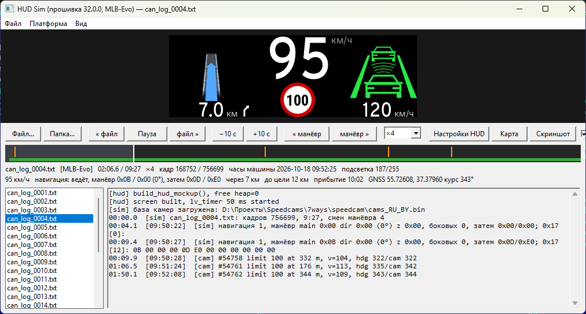
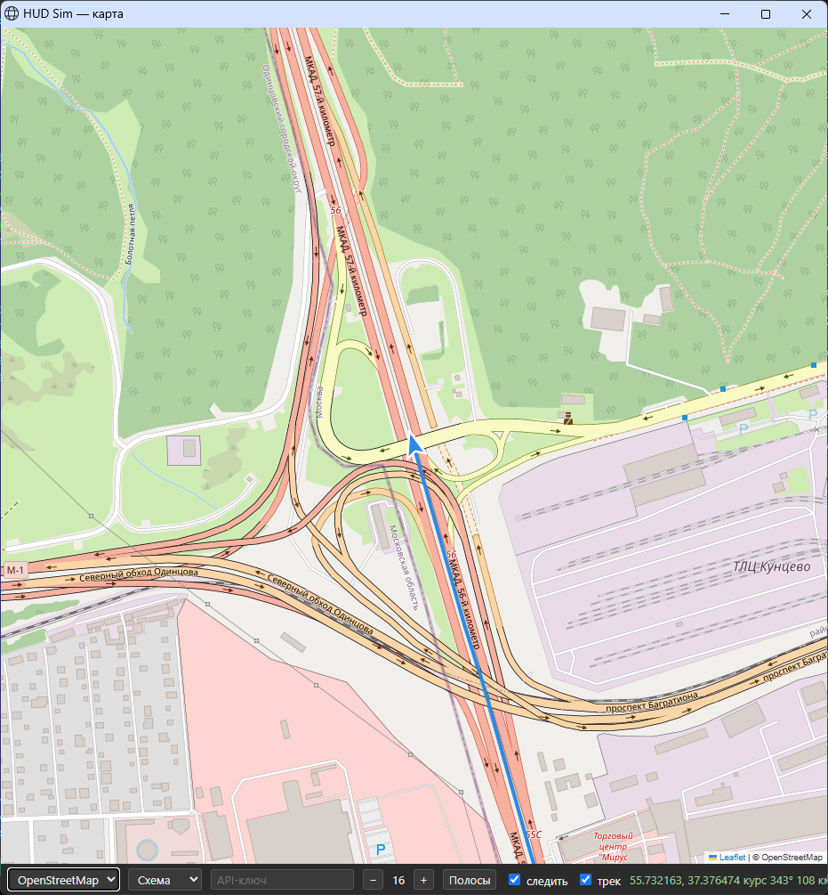

# HUD Sim — экран HUD Super Mini 2 на ПК (Windows) по логам сниффера

[English version: README_EN.md](README_EN.md)



Программа показывает экран HUD 428×142 на компьютере и проигрывает в него записанные логи
сниффера (`can_log_NNNN.txt`). Экран рисует **тот же код, что в прошивке**: `hud_mockup.c`,
`can_decode.c` (для MLB-Evo и для MQB), `hud_time.c`, `psd_speedlimit.c`, `cam_alert.c`, шрифты и
картинки берутся из `supermini_hud2/` без единой правки и собираются вместе с LVGL 8.4. Поменяли что-то в
экране или декодере — пересоберите `hud_sim.exe` и смотрите результат на реальной поездке,
не прошивая плату.

## Запуск

`hud_sim.exe` собирается `build_win.bat` (см. «Сборка»; в репозиторий он не входит), устанавливать ничего не нужно. Откройте файл лога или папку
поездки: кнопками, через меню «Файл», перетаскиванием в окно или аргументом командной строки:

```
hud_sim.exe D:\logs\trip
```

Файлы папки идут в списке слева и проигрываются подряд. Если метки времени следующего файла
продолжают предыдущий (та же поездка), HUD переходит на него без разрыва.

## Настройки HUD — отдельное окно

На самом HUD ни тачскрина, ни меню нет: в машине настройки меняются с Wi-Fi-портала
(`hud_portal.cpp`). В симуляторе их заменяет окно **«Настройки HUD»** (кнопка или клавиша `M`):
язык, единицы, знаки PSD / VZE, название улицы над стрелкой, допуск превышения скорости, камеры и
сигнал камер, громкость, датчик света (напряжение на нём задаёт ползунок). Окно применяет значения теми же вызовами `hud_set_*`,
что `hud_settings.cpp`; изменения видны сразу и сохраняются в `hud_sim.ini` (секция `[hud]`).
«По умолчанию» возвращает значения из `hud_config.h`.

## Платформа: MLB-Evo / MQB

Меню «Платформа» переключает карту CAN-сигналов декодера — то же, что `HUD_PLATFORM` в
`hud_config.h` (`HUD_PLATFORM_MLB_EVO` / `HUD_PLATFORM_MQB`). В прошивке это выбор при сборке,
поэтому в программу `can_decode.c` собран дважды, и экземпляры переключаются на ходу: текущее
место лога сразу проигрывается заново через выбранный декодер. Выбор запоминается в
`hud_sim.ini` и виден в заголовке окна и в строке состояния. Логи MQB открывайте с платформой
MQB, логи A4 — с MLB-Evo: по самому логу платформа не определяется.

## Управление

| Действие | Кнопка | Клавиша |
|---|---|---|
| Пуск / пауза | «Пуск» | Пробел |
| Назад / вперёд на 10 с (60 с) | «−10 с», «+10 с» | ← / → (с Shift) |
| Следующий / предыдущий манёвр навигации | «манёвр »», «« манёвр» | N / P |
| Скорость ×0.25 … ×32 | список | ↑ / ↓ |
| Следующий / предыдущий файл | «файл »», «« файл» | PgDn / PgUp |
| Настройки HUD | «Настройки HUD» | M |
| Скриншот (PNG в `shots\` и в буфер обмена) | «Скриншот» | S |

- **Шкала времени**: щелчок или протяжка — перемотка. Зелёная полоса — навигация ведёт по
  маршруту (BAP `RG_Status` = 1), оранжевые метки — смена манёвра (BAP `ManeuverDescriptor`).
- **Строки состояния**: позиция в файле, **часы машины** из лога (кадр CAN `0x6B2`, их же показывает
  HUD; в журнале они стоят в квадратных скобках после позиции), подсветка, которую выставил бы HUD,
  скорость, состояние навигации (манёвр, расстояние, бар-граф, до цели, время), название улицы, GNSS.
- **Журнал** (справа внизу): то, что прошивка пишет в Serial (`[hud]`, `[cam]`, `[nav]`,
  `[LVGL]` — по флагам `HUD_LOG_*` в `hud_config.h`), и строка на каждую смену манёвра с сырым
  сообщением BAP `0x17` — удобно разбирать новые коды стрелок.
- **Звук**: сигналы HUD (`hud_sound_play`) проигрываются теми же тоновыми последовательностями, что в
  `hud_sound.cpp` (меандр на динамик); громкость на ПК условная. Флажок «Звук» выключает вывод.

## Камеры

`cams.bin` — положите рядом с exe, перетащите в окно или выберите в меню «Файл» (путь запоминается
в `hud_sim.ini`). В машине база лежит во флеш-памяти W25Q128; в симуляторе вместо неё файл. Без
базы камеры не показываются.

## Сборка

Нужны `git` и компилятор в PATH: **zig** (`winget install -e --id zig.zig`) или MinGW-w64 `gcc`.

```
tools\hud_sim_win\build_win.bat
```

Папка прошивки — `..\..\supermini_hud2` (так лежит в репозитории); другую можно передать аргументом
один раз: `build_win.bat D:\path\to\supermini_hud2` (запоминается в `fw_path.txt`). LVGL 8.4.0
скачивается и компилируется один раз (несколько минут, объекты в `build\lv`), прошивка и симулятор
собираются заново при каждом запуске: все `*.c` из папки прошивки, кроме `can_decode.c`
(он идёт через `sim_decode_*.c`). Скрипт печатает версию прошивки, из которой собирает.

Linux / macOS / WSL: `build_headless.sh` собирает `hud_shot` — то же ядро без окна, кадр в BMP (скриншоты в `docs/screens/` сделаны именно так по реальным логам):

```
FW=/path/to/supermini_hud2 ./build_headless.sh
./hud_shot can_log_0001.txt 215 out.bmp [cams.bin]
SIM_LANG=1 SIM_UNITS=1 SIM_TOL=10 SIM_STREET=0 ./hud_shot ...      # настройки HUD из переменных окружения
```

## Что здесь не воспроизводится

Wi-Fi-портал и обновление ПО (вместо них файл лога и окно настроек), журнал во флеше, динамик и
датчик света как железо, зеркалирование `HUD_LCD_MIRROR_X` и сам дисплей NV3007 (цвет, яркость
подсветки): кадр — это 16-битный RGB565 LVGL, как в прошивке, но картинка на мониторе и на панели
выглядит по-разному.

## Файлы

| Файл | Что делает |
|---|---|
| `sim_core.c/.h` | время HUD = время лога, экран, заглушки железа, настройки, проигрыватель логов |
| `sim_win.c` | окно Windows: кнопки, шкала, список, журнал, окно настроек, скриншоты |
| `sim_headless.c` | `hud_shot`: кадр в BMP без окна |
| `sim_decode_mlb.c`, `sim_decode_mqb.c` | `can_decode.c` для двух платформ |
| `lv_conf.h`, `shim/` | конфиг LVGL и заглушки заголовков ESP-IDF / FreeRTOS |

## Карта (Яндекс / 2ГИС / OSM)



Кнопка «Карта» (клавиша K, меню «Вид») открывает отдельное окно (Edge/Chrome в режиме приложения, иначе браузер по умолчанию).
Сам hud_sim.exe поднимает локальный сервер на `127.0.0.1:8765` (порт — `[map] port` в `hud_sim.ini`, занят — берётся следующий) и
отдаёт страницу `map.html` (лежит рядом с exe, её можно править без пересборки) и текущие координаты из лога
(CAN 0x486 NavPos_01 + курс из 0x484), поэтому положение двигается вместе с проигрыванием и перемоткой.

* Яндекс и 2ГИС требуют свой API-ключ (бесплатный): Яндекс — JavaScript API в «Кабинете разработчика», 2ГИС — MapGL на platform.2gis.ru.
  Ключ вставляется в поле внизу окна карты (запоминается в браузере) или в `hud_sim.ini`: `[map] yandex_key=…`, `gis_key=…`.
* OpenStreetMap работает без ключа (максимум zoom 19, полос на нём нет) — для проверки, что координаты едут.
* Zoom: кнопки −/+ или клавиши, до 21. Кнопка «Полосы» включает спутник и максимальный zoom. «Следить» держит машину в центре, «трек» рисует пройденный путь.
* Нет фикса GNSS в кадре — маркер не двигается, внизу пишется «нет координат».

## Язык интерфейса

Интерфейс симулятора (кнопки, меню, строки состояния, журнал, окно настроек, окно карты) — на русском или английском.
Переключение: меню «Вид» → «Язык интерфейса» (Русский / English), действует сразу и запоминается в `hud_sim.ini`
(`[ui] lang=0` — русский, `1` — English). Пока не выбран вручную, берётся язык Windows (русский, украинский, белорусский → русский, иначе English).
Это не язык экрана HUD — он выбирается в окне «Настройки HUD» (поле «Язык»).

## Нагрузка на экран

Симулятор рисует так же, как прошивка: частично, полосами `HUD_STRIPE_H`, только изменившиеся области.
В первой строке состояния показано «перерисовок/с» и поток в панель в КБ/с — по ним видно, не перерисовывается ли экран впустую.
В `hud_shot` при проигрывании участка (`SIM_PLAY_FROM`) те же цифры печатаются в конце.
