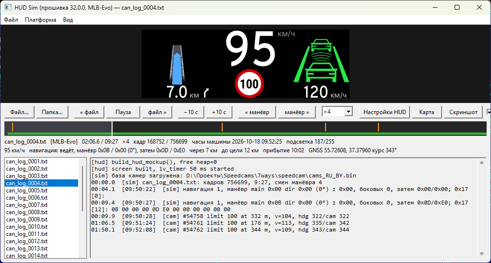
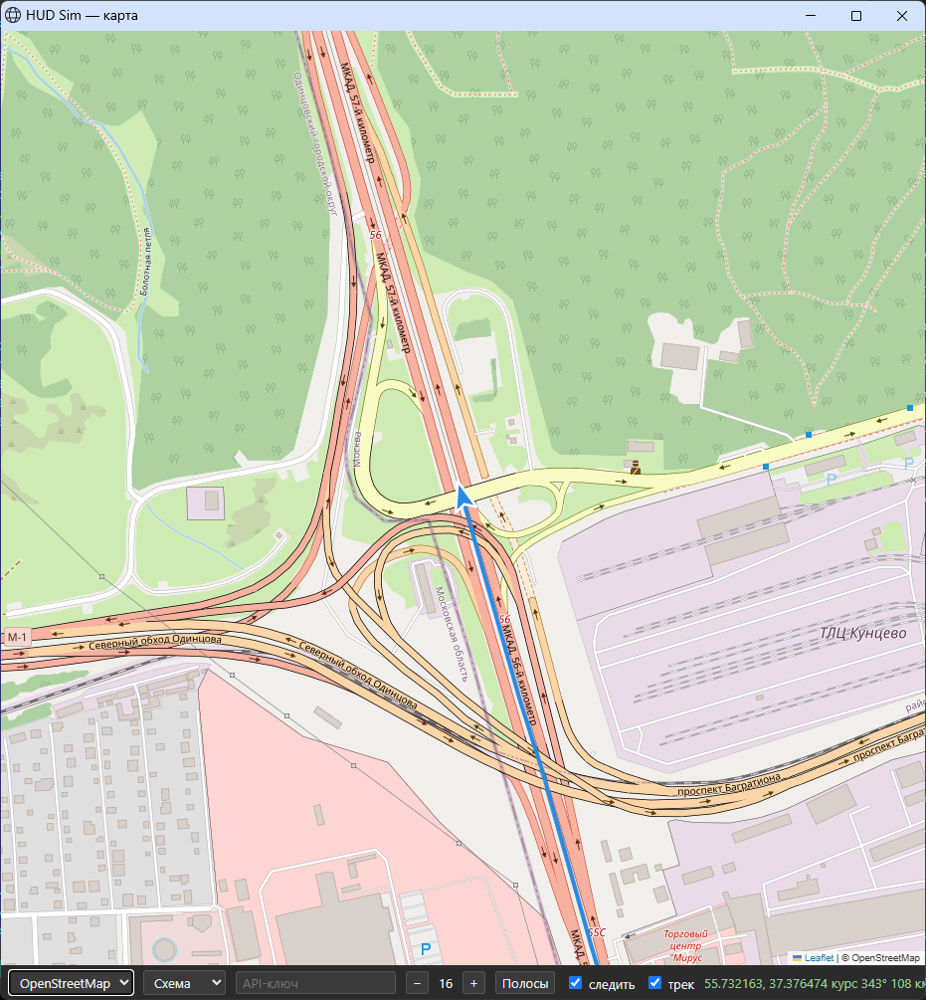

# HUD Sim — the Super Mini 2 HUD screen on a PC (Windows), driven by sniffer logs

[Русская версия: README.md](README.md)



The program shows the 428×142 HUD screen on a computer and plays recorded sniffer logs (`can_log_NNNN.txt`) into it. The screen is drawn by **the same code as in the firmware**: `hud_mockup.c`,
`can_decode.c` (for MLB-Evo and for MQB), `hud_time.c`, `psd_speedlimit.c`, `cam_alert.c`; fonts and images come from `supermini_hud2/` without a single edit and are built together with LVGL 8.4.
Changed something in the screen or decoder? Rebuild `hud_sim.exe` and look at the result on a real drive, without flashing the board.

## Running

`hud_sim.exe` is produced by `build_win.bat` (see "Building"; it is not stored in the repository), nothing else to install. Open a log file or a trip folder with the buttons, the "File" menu, by dragging into the window, or as a command-line argument:

```
hud_sim.exe D:\logs\trip
```

The files of the folder appear in the list on the left and play one after another. If the timestamps of the next file continue the previous one (same trip), the HUD moves to it seamlessly.

## HUD settings — a separate window

The real HUD has no touch screen or menu: in the car the settings are changed from the Wi-Fi portal (`hud_portal.cpp`). In the simulator they are replaced by the **"HUD settings"** window (button or `M` key):
language, units, PSD / VZE signs, street name above the arrow, overspeed tolerance, cameras and camera beep, volume, light sensor (its voltage is set by a slider). The window applies the values with the same `hud_set_*` calls as `hud_settings.cpp`;
changes are visible immediately and saved to `hud_sim.ini` (section `[hud]`). "Defaults" restores the values from `hud_config.h`.

## Platform: MLB-Evo / MQB

The "Platform" menu switches the CAN signal map of the decoder — the same as `HUD_PLATFORM` in `hud_config.h` (`HUD_PLATFORM_MLB_EVO` / `HUD_PLATFORM_MQB`). In the firmware this is a build-time choice,
so `can_decode.c` is built twice into the program and the instances are switched on the fly: the current position of the log is immediately replayed through the chosen decoder. The choice is remembered in
`hud_sim.ini` and shown in the window title and the status line. Open MQB logs with the MQB platform and A4 logs with MLB-Evo: the platform cannot be detected from the log itself.

## Controls

| Action | Button | Key |
|---|---|---|
| Play / pause | "Пауза" / "Пуск" | Space |
| Back / forward 10 s (60 s) | "−10 с", "+10 с" | ← / → (with Shift) |
| Next / previous navigation maneuver | "манёвр »", "« манёвр" | N / P |
| Speed ×0.25 … ×32 | list | ↑ / ↓ |
| Next / previous file | "файл »", "« файл" | PgDn / PgUp |
| HUD settings | "Настройки HUD" | M |
| Screenshot (PNG into `shots\` and the clipboard) | "Скриншот" | S |
| Map window | "Карта" | K |

- **Timeline**: click or drag to seek. The green bar means navigation is guiding along a route (BAP `RG_Status` = 1); orange marks are maneuver changes (BAP `ManeuverDescriptor`).
- **Status lines**: position in the file, the **car clock** from the log (CAN frame `0x6B2`, the same one the HUD uses; in the log pane it appears in square brackets after the position), the backlight the HUD would set,
  speed, navigation state (maneuver, distance, bargraph, distance to destination, time), street name, GNSS.
- **Log pane** (bottom right): what the firmware writes to Serial (`[hud]`, `[cam]`, `[nav]`, `[LVGL]` — controlled by the `HUD_LOG_*` flags in `hud_config.h`), plus one line per maneuver change with the raw
  BAP `0x17` message — handy for working out new arrow codes.
- **Sound**: HUD signals (`hud_sound_play`) are played with the same tone sequences as in `hud_sound.cpp` (a square wave to the speaker); the volume on a PC is nominal. The "Звук" checkbox turns the output off.

## Cameras

`cams.bin` — put it next to the exe, drag it into the window or pick it in the "File" menu (the path is remembered in `hud_sim.ini`). In the car the database lives in the W25Q128 flash; in the simulator a file replaces it.
Without a database no cameras are shown.

## Map (Yandex / 2GIS / OSM)



The "Map" button (key K, "View" menu) opens a separate window (Edge/Chrome in app mode, otherwise the default browser).
`hud_sim.exe` itself starts a local server on `127.0.0.1:8765` (the port is `[map] port` in `hud_sim.ini`; if busy, the next one is taken) and serves the `map.html` page (it lies next to the exe and can be edited without rebuilding)
and the current coordinates from the log (CAN 0x486 NavPos_01 + heading from 0x484), so the position moves together with playback and seeking.

* Yandex and 2GIS need their own (free) API key: Yandex — JavaScript API in the Developer's Console, 2GIS — MapGL at platform.2gis.ru.
  Paste the key into the field at the bottom of the map window (remembered in the browser) or into `hud_sim.ini`: `[map] yandex_key=…`, `gis_key=…`.
* OpenStreetMap works without a key (max zoom 19, no lane details) — for checking that the coordinates move.
* Zoom: −/+ buttons or keys, up to 21. The "Полосы" button switches on satellite view and maximum zoom. "следить" keeps the car in the centre, "трек" draws the path travelled.
* No GNSS fix in the frame — the marker does not move and "нет координат" is shown at the bottom.

## Building

You need `git` and a compiler in PATH: **zig** (`winget install -e --id zig.zig`) or MinGW-w64 `gcc`.

```
tools\hud_sim_win\build_win.bat
```

The firmware folder is `..\..\supermini_hud2` (as it lies in the repository); another one can be passed once as an argument: `build_win.bat D:\path\to\supermini_hud2` (remembered in `fw_path.txt`).
LVGL 8.4.0 is downloaded and compiled once (a few minutes, objects in `build\lv`); the firmware and simulator are rebuilt on every run: all `*.c` from the firmware folder except `can_decode.c`
(which goes through `sim_decode_*.c`). The script prints the version of the firmware it builds from.

Linux / macOS / WSL: `build_headless.sh` builds `hud_shot` — the same core without a window, one frame to BMP:

```
FW=/path/to/supermini_hud2 ./build_headless.sh
./hud_shot can_log_0001.txt 215 out.bmp [cams.bin]
SIM_LANG=1 SIM_UNITS=1 SIM_TOL=10 SIM_STREET=0 ./hud_shot ...      # HUD settings from environment variables
```

The screenshots in the repository's `docs/screens/` were made this way from real drive logs.

## What is not reproduced here

The Wi-Fi portal and software update (replaced by the log file and the settings window), the flash log, the speaker and light sensor as hardware, the `HUD_LCD_MIRROR_X` mirroring and the NV3007 display itself (colour,
backlight brightness): the frame is the 16-bit RGB565 LVGL output, as in the firmware, but the picture on a monitor and on the panel look different.

## Files

| File | What it does |
|---|---|
| `sim_core.c/.h` | HUD time = log time, screen, hardware stubs, settings, log player |
| `sim_win.c` | Windows window: buttons, timeline, list, log pane, settings window, screenshots |
| `sim_map.c/.h`, `map.html` | local map server and the map page |
| `sim_headless.c` | `hud_shot`: one frame to BMP without a window |
| `sim_decode_mlb.c`, `sim_decode_mqb.c` | `can_decode.c` for the two platforms |
| `lv_conf.h`, `shim/` | LVGL config and stub headers for ESP-IDF / FreeRTOS |

## Interface language

The simulator UI (buttons, menus, status lines, log, settings window, map window) is available in Russian and English.
Switch via the "View" menu → "Interface language" (Русский / English); it applies immediately and is stored in `hud_sim.ini`
(`[ui] lang=0` — Russian, `1` — English). Until chosen manually, the Windows UI language is used (Russian, Ukrainian, Belarusian → Russian, otherwise English).
This is not the HUD screen language — that one is set in the "HUD settings" window ("HUD language" field).
